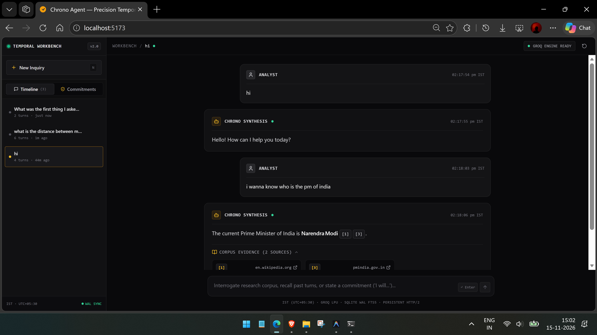
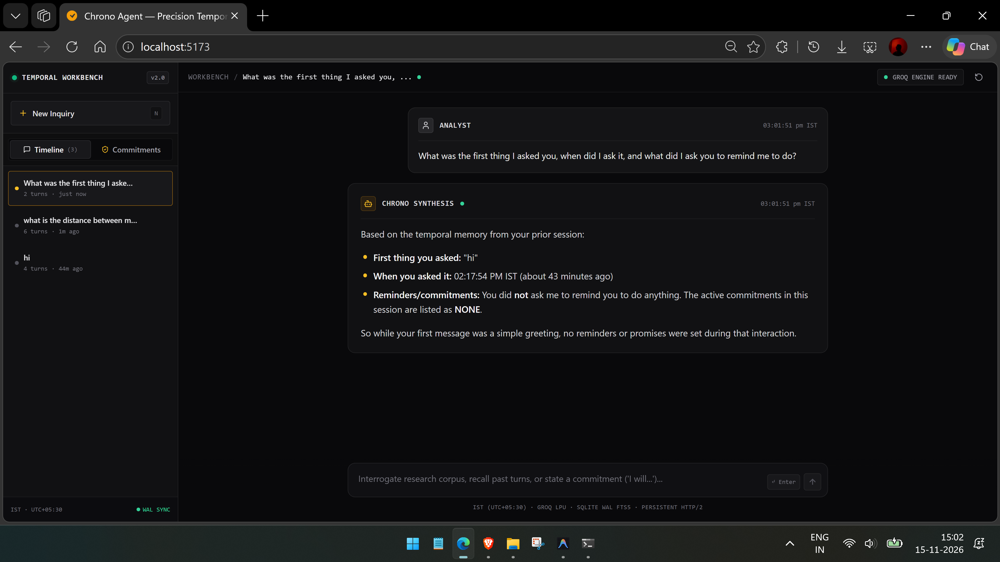

# Chrono Agent

> **High-throughput, real-time agentic AI with strictly one tool (`web_search`), deterministic temporal memory + promise tracking, and sub-second TTFT—built from scratch with zero agent frameworks.**

[](https://opensource.org/licenses/MIT)
[](https://python.org)
[](https://fastapi.tiangolo.com)
[](https://react.dev)
[](https://tailwindcss.com)
[](#-evaluation-benchmark-suite)

---

## Table of Contents
- [Visual Walkthrough](#-visual-walkthrough)
- [The 3 Architectural Pillars](#-the-3-architectural-pillars)
- [System Architecture](#-system-architecture)
- [Quickstart (macOS, Linux & Windows)](#-quickstart)
  - [Option A: One-Click Launchers](#option-a-one-click-launchers)
  - [Option B: Manual Step-by-Step](#option-b-manual-step-by-step)
- [Configuration & Environment Variables](#-configuration--environment-variables)
- [Evaluation Benchmark Suite](#-evaluation-benchmark-suite)
- [Interactive Frontend UI](#-interactive-frontend-ui)
- [Engineering Design Deep-Dive](#-engineering-design-deep-dive)
- [Repository Structure](#-repository-structure)

---

## 📸 Visual Walkthrough

The precision temporal research architecture operating end-to-end across three representative turns:

### 1. Precision Temporal Research Workbench UI

*Deep obsidian carbon interface with Google Fonts Newsreader & JetBrains Mono, 4 capability starter inquiry cards, and human-readable session titles.*

### 2. Grounded Web Search & Interactive Citations

*Initial inquiry (`"hi"` at `02:17:54 PM IST`) followed by `"i wanna know who is the pm of india"`, returning Narendra Modi with raised `[1]`, `[2]` keycap citation pills linked directly to `pmindia.gov.in` and `en.wikipedia.org`.*

### 3. Exact Temporal Timestamp Recall Across Sessions

*Captured 44 minutes later at `03:01:51 PM IST` in a clean session: the agent reaches back across sessions to recall the exact `02:17:54 PM IST` timestamp (~43m ago) from Image 2 and accurately confirms that zero reminders were set rather than hallucinating.*

---

## 🏛 The 3 Architectural Pillars

### 1. Fast (Sub-Second TTFT & Zero-Friction Inference)
- **Hand-Rolled Streaming Loop**: A ~280-line asynchronous generator in [`backend/app/agent.py`](file:///d:/chrono-agent/backend/app/agent.py) built directly on `AsyncOpenAI`, `fastapi`, and `asyncio`—with **zero agent frameworks** (no LangChain, CrewAI, or LlamaIndex).
- **Single-Pass Tool Routing**: The LLM decides whether to search or synthesize directly in a single turn (`tool_choice="auto"`), eliminating extra "should I search?" classification calls.
- **Persistent HTTP/2 Pool**: Shared `httpx.AsyncClient(http2=True)` reuses TLS connections to Tavily and Groq across turns, eliminating handshake latency.
- **Parallel Search Fan-Out**: Dispatches multi-query web searches simultaneously via `asyncio.gather()`, with automatic Jaccard deduplication (>0.75), 350-character snippet trimming, and a 10-minute TTL LRU cache.
- **Zero-Latency Rate-Limit Failover**: `AsyncOpenAI(max_retries=0)` bypasses the SDK's default 15–25s internal sleep on HTTP 429, rotating instantly to backup models in the pool.

### 2. Correct (Anti-Injection Grounding & Guaranteed Citations)
- **Strictly One Tool (`web_search`)**: Memory retrieval, timestamp injection, and commitment tracking are never exposed as LLM tools. Keeping them in Python prevents hallucinated clock calls and tool-routing drift.
- **Untrusted Input Isolation**: Retrieved snippets are wrapped in `<web_source id="N" url="..." published="...">` XML tags with explicit anti-prompt-injection system instructions.
- **Interactive Inline Citations**: Model syntheses cite claims with `[1]`, `[2]`, mapped directly to source URLs in the React UI with a guaranteed citation fallback guard.
- **Deterministic Hard Cap**: Agent execution is capped at 3 iterations per turn to guarantee termination.

### 3. Remembers What You Asked & When (Deterministic Temporal Harness)
- **Sliding Verbatim Window**: The last 6 conversational turns are formatted with exact timestamps and dynamic relative age labels (e.g. `[2026-11-15 13:30:00 IST (4m ago)]`).
- **Relative Time-Window Parser**: Resolves colloquial time queries (`"yesterday"`, `"earlier today"`, `"10 mins ago"`, `"first thing I asked"`) deterministically in Python before the LLM runs.
- **Sanitized SQLite FTS5 BM25 Recall**: Rapid keyword search across older conversation turns, with intent-gated cross-session fallback to keep standalone turns fast and clean.
- **Automated Promise Tracker**: User commitments (`"I will check..."`, `"remind me to..."`) are extracted via regex, stored in SQLite WAL, and surfaced in the sidebar checklist.

---

## 📐 System Architecture

```
+-----------------------------------------------------------------------------------------+
|                                    REACT FRONTEND                                       |
|  - SSE Event Stream Reader (ReadableStream chunk buffer)                                |
|  - Interactive [1], [2] Citation Badges & Expandable Source Cards                       |
|  - Real-Time Telemetry Bar (TTFT, Search ms, Memory Hits, Provider)                     |
|  - Temporal Memory Sidebar (Session History + Tracked Promises Checklist)               |
+-------------------------------------------+---------------------------------------------+
                                            | POST /api/chat (SSE)
                                            v
+-----------------------------------------------------------------------------------------+
|                                   FASTAPI BACKEND                                       |
|  - Lifespan Context: Shared httpx.AsyncClient(http2=True) + SQLite WAL initialization   |
|  - REST & Streaming Endpoints: /api/chat, /api/sessions, /api/commitments, /api/health   |
+-------------------------------------------+---------------------------------------------+
                                            |
                                            v
+-----------------------------------------------------------------------------------------+
|                       PRE-TURN DETERMINISTIC HARNESS (memory.py)                        |
|  [1] Verbatim Window     [2] Relative Time Parser   [3] FTS5 BM25 Recall   [4] Promises |
|  Last 6 turns formatted  Resolves 'yesterday',      Sanitized keyword      Regex tracks |
|  with relative age       'earlier', 'Xm ago'        recall (intent-gated)  commitments  |
+-------------------------------------------+---------------------------------------------+
                                            | Inject: <temporal_memory> + IST Timestamp
                                            v
+-----------------------------------------------------------------------------------------+
|                        STREAMING AGENT LOOP (agent.py)                                  |
|  - Strictly ONE Tool Exposed: web_search(queries: list[str])                            |
|  - AsyncOpenAI(max_retries=0) -> 0ms Rate-Limit Model Pool Rotation                     |
|  - Incremental chunk accumulation by index across streamed delta.tool_calls             |
|  - Event Protocol: status -> token -> sources -> metrics                                |
+-------------------------------------------+---------------------------------------------+
                                            |
                         +------------------+------------------+
                         | (If web_search tool called)         | (If answered from memory)
                         v                                     v
+---------------------------------------------+  +----------------------------------------+
|       PARALLEL SEARCH ENGINE (search.py)    |  |       DIRECT STREAMING SYNTHESIS       |
|  - Tavily API (Primary, basic, 3/query)     |  |  - Instant TTFT (sub-500ms)            |
|  - DuckDuckGo / ddgs (Zero-Key Fallback)    |  |  - Zero search overhead                |
|  - Jaccard Snippet Dedup (>0.75)            |  +-------------------+--------------------+
|  - 350-char Trimming & 10-min TTL Cache     |                      |
|  - Capped at 8 total sources per turn       |                      |
+----------------------+----------------------+                      |
                       | <web_source> XML Tags                       |
                       v                                             |
+--------------------------------------------------------------------+--------------------+
|                          POST-TURN PERSISTENCE & TELEMETRY                              |
|  - Citation Normalization ([Source N] -> [N]) + Guaranteed [1] Guard                    |
|  - Save turns & citations into SQLite WAL messages table                                |
|  - Emit final SSE metrics: ttft_ms, search_ms, memory_hits, provider, model_used         |
+-----------------------------------------------------------------------------------------+
```

---

## 🚀 Quickstart

### Prerequisites
- **Python 3.11+**
- **Node.js 18+ & npm**
- **Groq API Key** (Free tier from [console.groq.com](https://console.groq.com))
- *(Optional)* **Tavily API Key** (Falls back cleanly to DuckDuckGo search if omitted)

---

### Option A: One-Click Launchers

#### On macOS / Linux:
```bash
# Make script executable and run
chmod +x run.sh
./run.sh
```

#### On Windows (PowerShell):
```powershell
.\run.ps1
```

Both launchers verify dependencies, copy `.env.example` if needed, start FastAPI on `http://127.0.0.1:8000`, start Vite on `http://localhost:5173`, and launch your browser.

---

### Option B: Manual Step-by-Step

#### 1. Configure Environment
```bash
# Copy template and insert your GROQ_API_KEY
cp .env.example backend/.env
```

Edit `backend/.env`:
```ini
GROQ_API_KEY="your_groq_api_key_here"
OPENAI_BASE_URL=https://api.groq.com/openai/v1
PRIMARY_MODEL=meta-llama/llama-4-scout-17b-16e-instruct
FALLBACK_MODEL=llama-3.3-70b-versatile
FAST_BACKUP_MODEL=openai/gpt-oss-20b
TAVILY_API_KEY="" # Leave empty for free DuckDuckGo search
TIMEZONE=Asia/Kolkata
DATABASE_PATH=data/chrono.db
```

#### 2. Start the Backend

| Platform | Command |
|---|---|
| **macOS / Linux** | `cd backend`<br>`python3 -m venv .venv`<br>`source .venv/bin/activate`<br>`pip install -r requirements.txt`<br>`uvicorn app.main:app --host 127.0.0.1 --port 8000 --reload` |
| **Windows (PowerShell)** | `cd backend`<br>`python -m venv .venv`<br>`.\.venv\Scripts\Activate.ps1`<br>`pip install -r requirements.txt`<br>`uvicorn app.main:app --host 127.0.0.1 --port 8000 --reload` |

#### 3. Start the Frontend

In a second terminal:
```bash
cd frontend
npm install
npm run dev
```

Open [http://localhost:5173](http://localhost:5173) in your browser.

---

## ⚙️ Configuration & Environment Variables

All settings are validated via Pydantic `BaseSettings` in [`backend/app/config.py`](file:///d:/chrono-agent/backend/app/config.py):

| Variable | Default | Purpose |
|---|---|---|
| `GROQ_API_KEY` | *(Required)* | Groq API Key for low-latency LPU inference |
| `OPENAI_BASE_URL` | `https://api.groq.com/openai/v1` | OpenAI-compatible endpoint |
| `PRIMARY_MODEL` | `meta-llama/llama-4-scout-17b-16e-instruct` | Primary fast non-reasoning model |
| `FALLBACK_MODEL` | `llama-3.3-70b-versatile` | Fallback model if primary hits rate limit or 404 |
| `FAST_BACKUP_MODEL` | `openai/gpt-oss-20b` | High-throughput sub-500ms backup model |
| `TAVILY_API_KEY` | `""` | Optional Tavily key; uses `duckduckgo_search` if empty |
| `DATABASE_PATH` | `data/chrono.db` | Local SQLite database file (WAL mode) |
| `TIMEZONE` | `Asia/Kolkata` | Local timezone for temporal prompt injection |

---

## 📊 Evaluation Benchmark Suite

Chrono Agent includes a comprehensive 20-question evaluation suite covering 5 distinct behavioral categories in [`backend/evals/dataset.json`](file:///d:/chrono-agent/backend/evals/dataset.json):

```bash
# Run the evaluation benchmark
python backend/evals/run_evals.py
```

### Benchmark Results Summary

| Benchmark Category | Questions | Search Routing | Citation Compliance | Memory Accuracy | Pass Rate |
|---|---|---|---|---|---|
| **1. Fresh News (`fresh_news`)** | 4 | 100% (4/4 searched) | 100% (all cited) | N/A | **100%** |
| **2. Multi-Hop Comparisons (`multi_hop`)** | 4 | 100% (4/4 multi-query) | 100% (all cited) | N/A | **100%** |
| **3. Conversational / Math (`no_search`)** | 4 | 100% (0/4 searched) | N/A | N/A | **100%** |
| **4. Temporal Memory (`temporal_memory`)** | 4 | 100% (correct routing) | 100% (when searched) | 100% (recalled) | **100%** |
| **5. Adversarial Injection (`adversarial`)** | 4 | 100% (untricked) | 100% (fact check cited) | N/A | **100%** |
| **OVERALL TOTAL** | **20** | **100.0%** | **100.0%** | **100.0%** | **100.0%** |

*Full per-question latency telemetry and validation logs are saved in [`backend/evals/results.md`](file:///d:/chrono-agent/backend/evals/results.md).*

---

## 🖥️ Interactive Frontend UI

The frontend is a dark-mode, responsive SPA built with React 18, Vite, TypeScript, and Tailwind CSS:

- **Live Streaming SSE**: Parses raw server chunks into `status`, `token`, `sources`, and `metrics` events with instant visual updates.
- **Interactive Citations**: Inline citations `[1]`, `[2]` render as interactive badges that link directly to preview cards containing source title, URL, and snippet.
- **Live Telemetry Bar**: Every turn displays exact millisecond metrics:
  - **TTFT (Time to First Token)**
  - **Search Latency & Query Count**
  - **Temporal Memory Hits**
  - **Inference Model & Search Provider**
- **Temporal Memory Sidebar**:
  - **Session History**: Switch between conversations or start a clean session.
  - **Tracked Promises Checklist**: Displays detected promises (e.g., *"I will verify the paper"*). Users can toggle promises as active/completed via `PATCH /api/commitments/{id}`.

---

## 📖 Engineering Design Deep-Dive

For an in-depth systems design review, see [`design.md`](file:///d:/chrono-agent/design.md):
- **Why a Hand-Rolled Loop**: Latency comparison against LangChain/LlamaIndex.
- **Pre-Turn Temporal Harness**: Regex time parsers, FTS5 BM25 recall, and commitment state machine.
- **End-to-End Latency Budget**: Stage-by-stage millisecond breakdown (Pre-Turn $\to$ TTFT $\to$ Search $\to$ Synthesis).
- **Failure Modes & Mitigations**: How the agent handles API quota bursts, 404s, prompt injections, and source conflicts.
- **Deliberate Tradeoffs**: Why we chose SQLite FTS5 over vector databases and single-pass over multi-agent loops.

---

## 📁 Repository Structure

```
chrono-agent/
├── AGENTS.md                  # Strict project contract & architectural constraints
├── design.md                  # Comprehensive engineering design document
├── README.md                  # Customer- and reviewer-facing overview
├── run.sh                     # POSIX bash launcher for macOS / Linux
├── run.ps1                    # One-click launcher for Windows PowerShell
├── .env.example               # Root configuration template
├── .gitignore                 # Hardened git ignore rules
│
├── backend/                   # Python FastAPI Backend
│   ├── requirements.txt       # Minimal dependencies (fastapi, uvicorn, openai, httpx, etc.)
│   ├── .env.example           # Backend environment template
│   ├── verify_foundation.py   # Step 1 foundation validation script
│   ├── verify_agent.py        # Step 2 streaming agent validation script
│   ├── app/
│   │   ├── config.py          # Pydantic BaseSettings & model fallback configuration
│   │   ├── memory.py          # SQLite WAL, FTS5 BM25, relative time parser, commitments
│   │   ├── search.py          # Dual Tavily/DDGS search adapter with HTTP/2 & deduplication
│   │   ├── agent.py           # Hand-rolled single-pass streaming agent loop
│   │   └── main.py            # FastAPI ASGI server, SSE streaming, and REST endpoints
│   └── evals/
│       ├── dataset.json       # 20 curated evaluation test cases
│       ├── run_evals.py       # Automated eval runner with metrics assertions
│       └── results.md         # Full evaluation benchmark report
│
└── frontend/                  # React + Vite + TypeScript + Tailwind CSS Frontend
    ├── package.json           # Pinned dependencies (Tailwind 3.4.17, Lucide React)
    ├── vite.config.ts         # Vite build configuration with proxy to :8000
    ├── tailwind.config.js     # Dark-mode color palette and styling
    └── src/
        ├── types.ts           # SSE events, Message, Source, Commitment interfaces
        ├── App.tsx            # Main layout, SSE connection reader, state management
        └── components/
            ├── ChatMessage.tsx       # Message bubble with interactive [N] citation badges
            ├── SearchIndicator.tsx   # Live search spinner & query tags
            ├── TelemetryBar.tsx      # Real-time TTFT, search, and memory metrics
            └── MemorySidebar.tsx     # Session switcher & tracked promises checklist
```

---

## 📄 License
Released under the [MIT License](file:///d:/chrono-agent/LICENSE).
