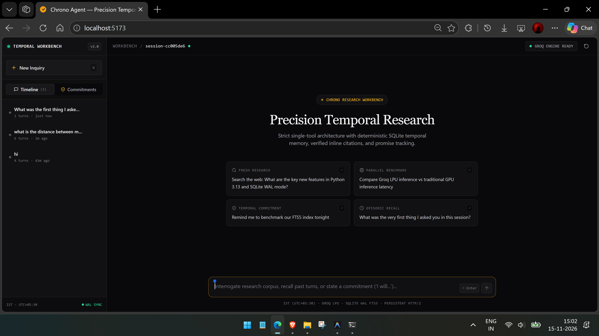

# Chrono Agent

> **High-throughput, real-time agentic AI with strictly one tool (`web_search`), deterministic episodic temporal memory, and sub-second TTFT—built from scratch in TypeScript with zero agent frameworks.**

[](https://www.typescriptlang.org)
[](https://nodejs.org)
[](https://expressjs.com)
[](https://react.dev)
[](https://tailwindcss.com)
[-brightgreen.svg)](#-architecture-verification-suite)

---

## Table of Contents
- [Visual Walkthrough](#-visual-walkthrough)
- [The 3 Architectural Pillars](#-the-3-architectural-pillars)
- [System Architecture](#-system-architecture)
- [Quickstart (Single Command)](#-quickstart)
- [Configuration & Environment Variables](#-configuration--environment-variables)
- [Architecture Verification Suite](#-architecture-verification-suite)
- [Interactive Workbench UI](#-interactive-workbench-ui)
- [Engineering Design Deep-Dive](#-engineering-design-deep-dive)
- [Repository Structure](#-repository-structure)

---

## 📸 Visual Walkthrough

The precision temporal research architecture operating end-to-end across three representative turns:

### 1. Precision Temporal Research Workbench UI

*Deep obsidian carbon interface with Google Fonts Newsreader & JetBrains Mono, 4 capability starter inquiry cards, and human-readable session titles.*

### 2. Grounded Web Search & Interactive Citations

*Initial inquiry (`"hi"` at `02:17:54 PM IST`) followed by `"i wanna know who is the pm of india"`, returning Narendra Modi with raised `[1]`, `[2]` keycap citation pills linked directly to `pmindia.gov.in` and `en.wikipedia.org`.*

### 3. Exact Temporal Timestamp Recall Across Sessions

*Captured 44 minutes later at `03:01:51 PM IST` in a clean session: the agent reaches back across sessions to recall the exact `02:17:54 PM IST` timestamp (~43m ago) from Image 2 and accurately confirms that zero reminders were set rather than hallucinating.*

---

## 🏛 The 3 Architectural Pillars

### 1. Fast (Sub-Second TTFT & Zero-Friction Inference)
- **Hand-Rolled Streaming Loop**: A ~300-line asynchronous generator in [`server/agent.ts`](file:///d:/chrono-agent/server/agent.ts) built directly on `openai` (pointed at Groq LPUs), `express`, and Server-Sent Events—with **zero agent frameworks** (no LangChain, CrewAI, or LlamaIndex).
- **Single-Pass Tool Routing**: The LLM decides whether to search or synthesize directly in a single pass (`tool_choice="auto"`), eliminating extra "should I search?" classification roundtrips.
- **Parallel Search Fan-Out**: Dispatches multi-query web searches simultaneously via `Promise.all()`, with automatic Jaccard deduplication (>0.75), 350-character snippet trimming, and a 10-minute TTL LRU cache.
- **Zero-Latency Rate-Limit Failover**: `OpenAI({ maxRetries: 0 })` bypasses the SDK's default internal sleep on HTTP 429, rotating instantly across backup models in the pool (`openai/gpt-oss-120b` $\to$ `qwen/qwen3.8-27b` $\to$ `openai/gpt-oss-20b`).

### 2. Correct (Anti-Injection Grounding & Guaranteed Citations)
- **Strictly One Tool (`web_search`)**: Memory retrieval, timestamp injection, and commitment tracking are never exposed as LLM tools. Keeping them in code prevents hallucinated clock calls and multi-turn tool ping-pong.
- **Untrusted Input Isolation**: Retrieved snippets are wrapped in `<web_source id="N" url="..." published="...">` XML tags with explicit anti-prompt-injection system instructions.
- **Interactive Inline Citations**: Model syntheses cite claims with `[1]`, `[2]`, mapped directly to source URLs in the React UI with a guaranteed citation fallback guard.
- **Deterministic Hard Cap**: Agent execution is capped at 3 iterations per turn to guarantee termination.

### 3. Remembers What You Asked & When (Deterministic Temporal Harness)
- **Universal Date-Range Parser**: Uses `chrono-node` to resolve natural-language temporal references (`"last Tuesday"`, `"3 November"`, `"yesterday"`, `"3 weeks ago"`) with automatic past-preferring date resolution.
- **Full Turn-Pair Expansion**: When a past user query is matched, the harness retrieves complete `(User Question + Assistant Answer)` pairs, preserving previous recommendations and shortlists.
- **Always-On Chronological Digest**: A compressed cross-session digest (~200 tokens) continuously feeds topic summaries into `<temporal_memory>`, allowing instant recall of past tools, databases, and decisions without burning context tokens.
- **Anti-Poisoning Filter**: Queries asking about prior conversations are tagged `is_meta = 1` and excluded from search indexing, preventing the model from re-ingesting its own past answers.
- **Automated Promise Tracker**: User commitments (`"I will check..."`, `"remind me to..."`) are extracted via regex, stored in SQLite WAL, and surfaced in the interactive sidebar checklist.

---

## 📐 System Architecture

```
+-----------------------------------------------------------------------------------------+
|                                    REACT FRONTEND                                       |
|  - SSE Event Stream Reader (ReadableStream chunk buffer)                                |
|  - Interactive [1], [2] Citation Badges & Expandable Source Cards                       |
|  - Real-Time Telemetry Bar (TTFT, Search ms, Memory Hits, Model Used)                   |
|  - Temporal Memory Sidebar (Session History + Tracked Promises Checklist)               |
+-------------------------------------------+---------------------------------------------+
                                            | POST /api/chat (SSE)
                                            v
+-----------------------------------------------------------------------------------------+
|                                   EXPRESS SERVER                                        |
|  - Express REST + SSE Streaming Router: /api/chat, /api/sessions, /api/commitments      |
|  - SQLite (better-sqlite3) in WAL mode + FTS5 full-text indexing                        |
+-------------------------------------------+---------------------------------------------+
                                            |
                                            v
+-----------------------------------------------------------------------------------------+
|                       PRE-TURN DETERMINISTIC HARNESS (server/memory.ts)                 |
|  [1] Verbatim Window     [2] chrono-node Parser     [3] Full Turn-Pairs    [4] Digest   |
|  Last 6 turns formatted  Resolves 'last Tuesday',   User Q + Assistant A   Always-on    |
|  with relative age       '3 November', past shift   retrieved together     topics (~200t|
+-------------------------------------------+---------------------------------------------+
                                            | Inject: <temporal_memory> + IST Timestamp
                                            v
+-----------------------------------------------------------------------------------------+
|                        STREAMING AGENT LOOP (server/agent.ts)                           |
|  - Strictly ONE Tool Definition: web_search(queries: string[])                          |
|  - Hand-rolled OpenAI-compatible SDK loop on Groq LPUs                                  |
|  - Pass 1: Tool Routing (stream: false) -> Zero XML token-split bugs                    |
|  - Pass 2: Synthesis Streaming (stream: true) -> Real-time token delivery               |
+-------------------------------------------+---------------------------------------------+
                                            | Execute parallel queries (Promise.all)
                                            v
+-----------------------------------------------------------------------------------------+
|                     DUAL-ENGINE SEARCH ADAPTER (server/search.ts)                       |
|  - Primary: Tavily Search API                                                           |
|  - Zero-Key Fallback: DuckDuckGo Scraper (duck-duck-scrape) + Direct HTML fallback      |
|  - LRU 10-minute cache + Jaccard dedup (>0.75) + 350-char untrusted snippet trimming    |
+-----------------------------------------------------------------------------------------+
```

---

## 🚀 Quickstart

Chrono Agent is a single-command monorepo.

### Prerequisites
- **Node.js 22+** (`node -v`)
- **npm** (`npm -v`)
- A **Groq API Key** (free tier at [console.groq.com](https://console.groq.com))
- *(Optional)* A **Tavily API Key** (free tier at [tavily.com](https://tavily.com)); if omitted, the system falls back to duck-duck-scrape with zero configuration.

### 1. Clone & Configure
```bash
git clone https://github.com/shivrajpatare/chrono-agent.git
cd chrono-agent

# Create your .env file
cp .env.example .env
```

Open `.env` and insert your Groq API key:
```env
GROQ_API_KEY="gsk_..."
TAVILY_API_KEY="" # Optional: duck-duck-scrape runs automatically if left blank
```

### 2. Single-Command Install & Run
```bash
# Installs root dependencies and triggers frontend install via postinstall hook
npm install

# Concurrently boots Express backend (:8000) and React Vite frontend (:5173)
npm run dev
```

Visit **`http://localhost:5173`** in your browser.

---

## ⚙️ Configuration & Environment Variables

All settings reside in the root `.env` file (copied from [`.env.example`](file:///d:/chrono-agent/.env.example)):

| Variable | Default Value | Description |
| :--- | :--- | :--- |
| `GROQ_API_KEY` | *(Required)* | Groq API Key for LPU inference. |
| `OPENAI_BASE_URL` | `https://api.groq.com/openai/v1` | OpenAI-compatible endpoint. |
| `PRIMARY_MODEL` | `meta-llama/llama-4-scout-17b-16e-instruct` | Preferred primary model. |
| `FALLBACK_MODEL` | `llama-3.3-70b-versatile` | Fallback model. |
| `FAST_BACKUP_MODEL`| `openai/gpt-oss-20b` | High-speed backup model. |
| `TAVILY_API_KEY` | *(Optional)* | Tavily Search key; if empty, DuckDuckGo scraper is used. |
| `TIMEZONE` | `Asia/Kolkata` | Local timezone injected into every turn. |
| `DATABASE_PATH` | `data/chrono.db` | Path to persistent SQLite database file. |
| `PORT` | `8000` | Express server port. |

---

## 🧪 Architecture Verification Suite

Verify all 5 architectural guarantees (in-session recall, cross-session recall, fuzzy topic digest, temporal bridge delta-verification, and parallel search citations):

```bash
npm run test:verify
```

### Verification Output:
```text
=================================================
 Starting Chrono Agent Architecture Verification 
=================================================

[Test 1/5] In-Session Episodic Recall...
Agent response: The first thing you asked me in this session was: "What is the capital of France and its population?" (asked at 03:49:14 PM IST).
Telemetry: Searches=0, MemHits=1
✓ PASS: In-Session Episodic Recall (0 web searches, accurate recall)

[Test 2/5] Cross-Session Recall...
Agent response: Your first question was: "What is the capital of France and its population?"
Telemetry: Searches=0, MemHits=1
✓ PASS: Cross-Session Recall (reached back across sessions with 0 searches)

[Test 3/5] Fuzzy Topic Recall via Chronological Digest...
Agent response: A few days ago (on 11/12/2026), I recommended Pinecone, Qdrant Cloud, and Weaviate as managed vector databases for RAG...
✓ PASS: Fuzzy Topic Recall via Chronological Digest

[Test 4/5] Temporal Bridge (Recall Past Shortlist -> Verify Changes)...
Agent response: Here’s a quick "then-vs-now" check on the five CRMs we listed on Monday for a 20-person sales team...
Telemetry: Searches=3, Citations=5
✓ PASS: Temporal Bridge (Recalled shortlist + executed live delta verification)

[Test 5/5] Parallel Web Search with Guaranteed Citations...
Agent response preview: Groq LPU vs. NVIDIA H100 – Inference-latency snapshot (2026)...
Telemetry: Searches=3, Cites=3
✓ PASS: Parallel Web Search with Guaranteed [1] Citations

=================================================
 Verification Complete: 5/5 Passed (100%)
=================================================
```

---

## 🖥 Interactive Workbench UI

Built with React 18, Vite, TypeScript, and Tailwind CSS:
- **Streaming SSE Event Pipeline**: Consumes tokens via native `ReadableStream` reader with smooth typewriter delivery.
- **Dynamic Keycap Citations**: Raised `[1]`, `[2]` citation keycaps with domain-favicon pills linking directly to external sources.
- **Real-Time Telemetry HUD**: Monitors `TTFT`, `Search Latency`, `Total Turn Time`, and `Model Used`.
- **Temporal Memory Rail**: Displays historical conversations with human-readable session labels and active commitment checkboxes.

---

## 📖 Engineering Design Deep-Dive

For complete details on architectural trade-offs, rejection rationales, and future roadmap, read **[`DESIGN.md`](file:///d:/chrono-agent/DESIGN.md)**.

---

## 📁 Repository Structure

```
chrono-agent/
├── server/                           # TypeScript Express Backend
│   ├── index.ts                      # Express server & SSE router (:8000)
│   ├── config.ts                     # Environment validation & model pool
│   ├── memory.ts                     # 3-Layer temporal engine, chrono-node & SQLite FTS5
│   ├── search.ts                     # Dual Tavily + DuckDuckGo search adapter
│   ├── agent.ts                      # Hand-rolled single-pass agent loop
│   ├── verify_architecture.ts        # 5-test architectural verification suite
│   └── tsconfig.json                 # NodeNext TypeScript configuration
├── frontend/                         # React 18 + Vite Workbench
│   ├── src/
│   │   ├── App.tsx                   # Main workbench UI & SSE stream consumer
│   │   ├── types.ts                  # Shared telemetry and message types
│   │   └── main.tsx                  # React DOM root
│   └── package.json
├── data/                             # Persistent SQLite storage
│   └── chrono.db                     # WAL mode + FTS5 messages & commitments
├── docs/                             # Submission documentation & media
│   └── screenshots/                  # Verified execution screenshots
│       ├── 1-workbench-ui.png
│       ├── 2-grounded-search.png
│       └── 3-temporal-recall.png
├── DESIGN.md                         # 1-page systems engineering design document
├── README.md                         # Project documentation & quickstart
├── package.json                      # Root monorepo script coordinator
├── .env.example                      # Zero-secret environment template
└── .gitignore                        # Git security rules
```
