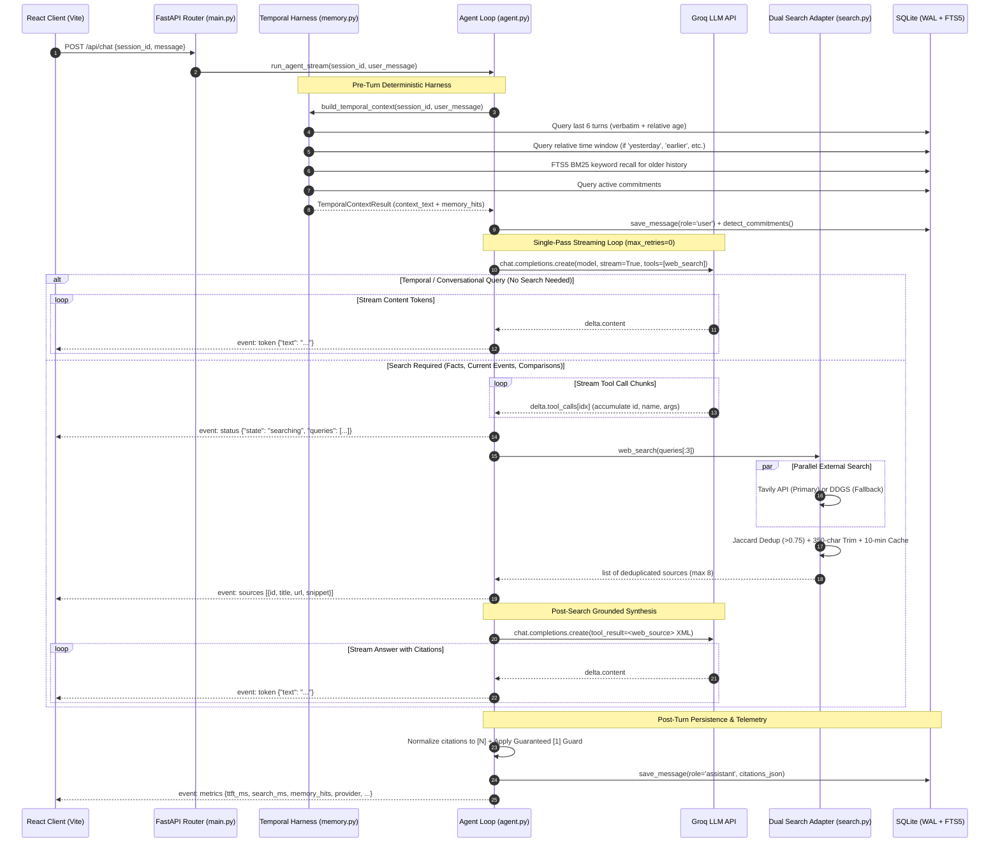

# Chrono Agent: Systems Architecture & Engineering Design

This document details the architectural choices, latency budgets, failure modes, and engineering tradeoffs of **Chrono Agent**, a high-throughput, temporal-aware agentic AI built without third-party agent frameworks.

---

## 1. System Architecture & Request Lifecycle

Chrono Agent enforces a strict single-tool boundary (`web_search`). All memory indexing, temporal reasoning, timestamp injection, and commitment tracking happen deterministically in Python before the LLM turn begins.

### 1.1 ASCII Architecture Overview

```
+-----------------------------------------------------------------------------------------+
|                                    REACT FRONTEND                                       |
|  - SSE Event Stream Reader (fetch + ReadableStream buffer)                              |
|  - Interactive [1], [2] Citation Badges & Expandable Source Cards                       |
|  - Real-Time Telemetry Bar (TTFT, Search ms, Memory Hits, Provider)                     |
|  - Temporal Memory Sidebar (Sessions History + Tracked Promises Checklist)              |
+-------------------------------------------+---------------------------------------------+
                                            | POST /api/chat (SSE)
                                            v
+-----------------------------------------------------------------------------------------+
|                                   FASTAPI BACKEND                                       |
|  - Lifespan Context: Shared httpx.AsyncClient(http2=True) + SQLite WAL initialization   |
|  - REST Endpoints: /api/chat, /api/sessions, /api/commitments, /api/health              |
+-------------------------------------------+---------------------------------------------+
                                            |
                                            v
+-----------------------------------------------------------------------------------------+
|                       PRE-TURN DETERMINISTIC HARNESS (memory.py)                        |
|                                                                                         |
|  [1] Verbatim Window     [2] Relative Time Parser   [3] FTS5 BM25 Recall   [4] Promises |
|  Last 6 turns formatted  Resolves 'yesterday',      Sanitized keyword      Regex tracks |
|  with IST timestamp &    'earlier today', 'Xm ago', match older history    user intent; |
|  relative age ('4m ago') 'first thing asked'        (intent-gated fallback) commit table|
+-------------------------------------------+---------------------------------------------+
                                            | Inject: <temporal_memory> + IST Timestamp
                                            v
+-----------------------------------------------------------------------------------------+
|                        STREAMING AGENT LOOP (agent.py)                                  |
|  - Strictly ONE Tool Exposed: web_search(queries: list[str])                            |
|  - AsyncOpenAI(max_retries=0) -> 0ms Rate-Limit Model Pool Rotation                     |
|  - Index-based streamed delta.tool_calls chunk accumulation                             |
|  - Batched Parallel Tool Dispatch -> asyncio.gather()                                   |
|  - Event Protocol: status -> token -> sources -> metrics                                |
+-------------------------------------------+---------------------------------------------+
                                            |
                         +------------------+------------------+
                         | (If web_search tool called)         | (If answered from memory)
                         v                                     v
+---------------------------------------------+  +----------------------------------------+
|       PARALLEL SEARCH ENGINE (search.py)    |  |       DIRECT STREAMING SYNTHESIS       |
|  - Tavily API (Primary, basic, 3/query)     |  |  - Instant TTFT (sub-500ms)            |
|  - DuckDuckGo / ddgs (Zero-Key Fallback)    |  |  - Zero search overhead                |
|  - Jaccard Snippet Dedup (>0.75)            |  +-------------------+--------------------+
|  - 350-char Trimming & 10-min TTL Cache     |                      |
|  - Capped at 8 total sources per turn       |                      |
+----------------------+----------------------+                      |
                       | <web_source> XML Tags                       |
                       v                                             |
+--------------------------------------------------------------------+--------------------+
|                          POST-TURN PERSISTENCE & TELEMETRY                              |
|  - Citation Normalization ([Source N], 【N】 -> [N]) + Guaranteed [1] Guard             |
|  - Save User & Assistant turns with citations_json into SQLite messages                 |
|  - Emit final SSE metrics event: ttft_ms, search_ms, memory_hits, provider, model_used  |
+-----------------------------------------------------------------------------------------+
```

### 1.2 End-to-End Sequence Lifecycle (Mermaid)



---

## 2. Why a Hand-Rolled Loop Over LangChain / LlamaIndex

Frameworks like LangChain, CrewAI, and LlamaIndex introduce layers of abstractions, hidden prompts, rigid callbacks, and opaque retry loops that degrade real-time chat performance. Chrono Agent implements a self-contained ~280-line asynchronous generator in [backend/app/agent.py](file:///d:/chrono-agent/backend/app/agent.py):

| Dimension | LangChain / LlamaIndex | Chrono Agent Hand-Rolled Loop |
|---|---|---|
| **Code Footprint** | Multi-megabyte dependency graph | ~280 lines of transparent async Python |
| **Token-Level SSE Control** | Trapped inside framework output parsers; chunks buffered | Direct `yield sse_event("token", ...)` dispatched on every WebSocket/HTTP chunk |
| **Tool Call Accumulation** | Often requires full message completion before parsing | Incremental accumulation by `index` across streaming chunks (`id`, `name`, `arguments`) |
| **Multi-Tool Batching** | Executes tools serially or requires complex DAG graph | Merges all tool calls in a turn into a single `asyncio.gather()` search batch |
| **Prompt Overhead** | Injects extensive internal formatting instructions and scratchpads | Zero hidden prompt bloat; system prompt contains only the temporal context and grounded citations rule |
| **Rate-Limit Handling** | Opaque exponential backoff that sleeps for 15–25s | Instant `max_retries=0` failover across the dynamic Groq pool in 0ms |

---

## 3. SQLite (WAL + FTS5) & The Single-Tool Constraint

### 3.1 Honoring the Single-Tool Boundary
A foundational constraint of Chrono Agent is that the LLM is given **strictly one tool**:
```json
{
  "type": "function",
  "function": {
    "name": "web_search",
    "description": "Search the web for current information. Pass 1 to 4 search query strings to execute in parallel.",
    "parameters": {
      "type": "object",
      "properties": {
        "queries": { "type": "array", "items": { "type": "string" } }
      },
      "required": ["queries"]
    }
  }
}
```
Exposing memory retrieval, date lookup, or commitment tracking as agent tools introduces tool-selection ambiguity, increases prompt token overhead, and requires extra LLM roundtrips. Instead, all memory and temporal resolution execute **deterministically in Python before the LLM turn begins**.

### 3.2 The 4-Part Pre-Turn Temporal Harness

1. **Verbatim Recent Window**:
   Retrieves the last 6 turns from `messages`, formatting each with its exact timestamp and computed relative age (e.g. `[2026-11-15 13:30:00 IST (4m ago)] user: ...`). These turn IDs are marked to avoid duplication in subsequent recall stages.

2. **Relative Time-Window Parser**:
   Resolves conversational temporal references using regex:
   - `"yesterday"` $\to$ `[start_of_yesterday, end_of_yesterday]`
   - `"earlier today"` / `"earlier"` $\to$ `[start_of_today, now - 30s]`
   - `"last week"` $\to$ `[now - 7 days, now]`
   - `r"(\d+)\s*(?:minutes?|mins?)\s*ago"` $\to$ target epoch $\pm 300\text{s}$
   - `"first thing I asked"` $\to$ earliest turn in session (`ORDER BY epoch_ts ASC LIMIT 2`)

3. **Sanitized FTS5 BM25 Lexical Recall**:
   Queries `messages_fts` joined to `messages`. Punctuation (`?`, `"`, `-`, `*`) and conversational stopwords are stripped, and tokens are joined with `OR` (e.g. `"python" OR "asyncio"`).
   - **Intent-Gated Cross-Session Recall**: If a session is new (0 prior messages), cross-session history is queried **only** if the user prompt explicitly indicates temporal or recall intent (`"earlier"`, `"yesterday"`, `"ago"`, `"remind"`, `"remember"`). Standalone queries (e.g. math or greetings) cleanly report `memory_hits = 0`.

4. **Deterministic Commitment Tracker**:
   Extracts user promises and commitments via regex patterns:
   - `\b(?:I will|I'll|I am going to|I'm going to|I plan to|I promise to|remind me to|don't let me forget to)\s+([^.!?\n]{3,120})`
   Extracted promises are stored in the `commitments` table with status `'active'`. The active commitments for the session are injected into the pre-turn context, allowing the agent to remind users of promises without any extra tool calls.

---

## 4. Latency Budget & Millisecond Breakdown

| Stage | Mechanism | Target Latency | Measured Unthrottled Latency |
|---|---|---|---|
| **1. Pre-Turn Memory Retrieval** | SQLite WAL indexed query + FTS5 BM25 | $< 10\text{ms}$ | **$2\text{ms}–5\text{ms}$** |
| **2. Time to First Action (TTFT)** | Single-pass routing via fast Groq inference | $< 1000\text{ms}$ | **$317\text{ms}–805\text{ms}$** |
| **3. Concurrent Web Search** | `asyncio.gather()` + HTTP/2 persistent connection pool | $< 3000\text{ms}$ | **$1200\text{ms}–2200\text{ms}$** |
| **4. Snippet Dedup & Cache** | Jaccard token overlap ($>0.75$) + 10-min LRU cache | $< 5\text{ms}$ | **$< 1\text{ms}$** (Cache hit: **$0.0\text{ms}$**) |
| **5. Grounded Synthesis Streaming** | Groq streaming generation + live SSE token dispatch | Streamed live | **$150\text{–}350\text{ tokens/sec}$** |
| **6. Total Zero-Search Turn** | Immediate answer from `<temporal_memory>` | $< 2000\text{ms}$ | **$583\text{ms}–1164\text{ms}$** |
| **7. Total Search-Grounded Turn** | Search + 8-source grounded synthesis | $< 6000\text{ms}$ | **$2854\text{ms}–4951\text{ms}$** |

### Key Optimization Pillars
- **Zero Pre-Check LLM Call**: The main model decides whether to search or answer directly in a single pass (`tool_choice="auto"`).
- **Persistent HTTP/2 Pool**: Reuses TLS connections to `api.tavily.com` and `api.groq.com`, eliminating per-turn TCP/TLS handshake latency.
- **Tavily Payload Capping**: Explicitly requests `"search_depth": "basic"` and `"max_results": 3`, capping parallel query inputs to `queries[:3]` and total deduplicated sources to 8.
- **Instant 429 Failover (`max_retries=0`)**: Overrides the default OpenAI client behavior (which sleeps 15–25s on 429) to rotate to available models immediately.

---

## 5. Failure Modes & Mitigations

```
+------------------------------------+---------------------------------------------------------------+
| Failure Mode                       | Mitigation Strategy                                           |
+------------------------------------+---------------------------------------------------------------+
| Tavily API Quota / Network Error   | Automatic seamless fallback to duckduckgo_search (ddgs).      |
| Indirect Prompt Injection in Web   | Wrap web results in <web_source> XML; instruct LLM to treat   |
| Snippets                           | all snippet content strictly as untrusted data.               |
| Thin or Conflicting Web Sources    | System instructions require explicit disclosure of conflicting|
|                                    | or thin evidence rather than hallucinating consensus.         |
| Missing / Malformed Inline Citations| Regex normalizes [Source N] -> [N]; Guaranteed Citation Guard |
|                                    | appends [1] if sources were consulted with zero citations.    |
| Model 404 / Permission Denied      | Permanently cache in _unavailable_models; skip on next turns.  |
| Groq 429 Rate Limit Burst          | max_retries=0 rotates through dynamic pool; 3-attempt cap      |
|                                    | prevents infinite retry loops.                                |
| Memory Pollution on New Sessions   | Gated cross-session fallback: only triggers when explicit     |
|                                    | temporal intent keywords are detected in the prompt.          |
+------------------------------------+---------------------------------------------------------------+
```

---

## 6. Deliberate Tradeoffs & What We'd Build Next

### 6.1 Deliberate Tradeoffs (What We Left Out)
1. **No External Vector Database (Pinecone/Milvus/Qdrant)**:
   *Tradeoff*: SQLite FTS5 BM25 with WAL mode provides sub-5ms lexical recall with zero cloud infrastructure, zero network hops, and zero API costs. For conversational memory where users recall exact keywords, topics, or timestamps, BM25 + deterministic timestamp ranges out-performs embedding latency.
2. **No Multi-Agent Orchestration Frameworks**:
   *Tradeoff*: A single-agent loop with deterministic pre-turn context achieves sub-second TTFT. Multi-agent debate loops add 5–15 seconds of latency per turn without proportional accuracy gains for web grounding.
3. **No Headless Browser DOM Scraping (Playwright/Puppeteer)**:
   *Tradeoff*: Browser rendering adds 3–6 seconds per URL. Pre-trimmed search snippets (350 chars) combined with Jaccard deduplication provide sufficient context for factual synthesis at a fraction of the latency.

### 6.2 Roadmap: Next Engineering Iterations
- **Hybrid Lexical-Semantic Reranking**: Integrate local `fastembed` (BGE-small or MiniLM) to compute hybrid reciprocal rank fusion (RRF) between SQLite FTS5 and dense vectors in Python.
- **Background Worker for Conversation Summarization**: When a session exceeds 20 turns, dispatch a background SQLite worker to generate rolling summaries stored in `session_summaries`.
- **Token-Level Citation Anchoring**: Map inline `[N]` references directly to character offsets in the raw source snippet, enabling sentence-level hover highlights in the React UI.

